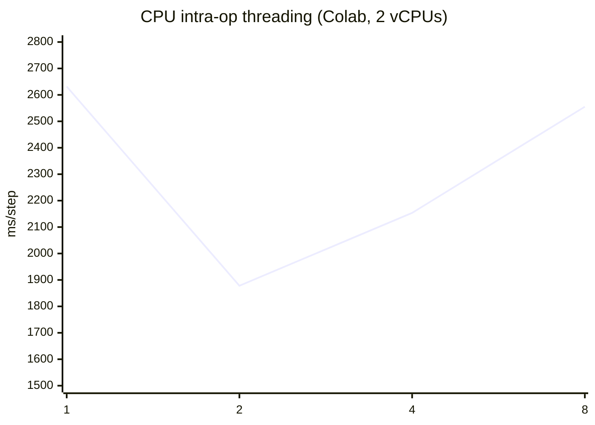

# Phase 2 — Reflection: where does parallelism stop helping?

Copy this file to `submission/phase2_reflection.md`, fill in every answer slot, and commit it:

```bash
cp phase-2-tiny-gpt/reflection_template.md submission/phase2_reflection.md
```

**How to fill it in.** Each answer sits between a pair of `<!--answer:...-->` markers. Replace
the `TODO` line with your answer — **leave the markers themselves untouched**, they are how the
grader finds your answers. Anything you write outside the markers is ignored, so add extra
prose, tables or your threading plot freely.

Numbers in section 1 must **match `submission/phase2_report.json`** — copy them across, do not
retype from memory; they are checked against it.

---

## 1. Your measurements

| | Value |
|---|---|
| Naive attention, ms (`attention.naive_ms`) | <!--answer:attn_naive_ms-->238.437<!--/answer--> |
| Vectorized attention, ms (`attention.vectorized_ms`) | <!--answer:attn_vectorized_ms-->0.884<!--/answer--> |
| CPU training, ms for 100 steps (`devices.cpu_ms`) | <!--answer:cpu_ms-->427371.3<!--/answer--> |
| GPU training, ms for 100 steps (`devices.gpu_ms`) | <!--answer:gpu_ms-->12629.2<!--/answer--> |
| Final training loss (`training.final_loss`) | <!--answer:final_loss-->1.4823<!--/answer--> |

**The thread sweep.** Give your four timings from `threads` — 1, 2, 4 and 8 threads — and say
which count was fastest. (verbatim: the numbers, in order)

<!--answer:thread_sweep-->
2631.728, 1878.055, 2153.654, 2555.312. Fastest: 2 threads.
<!--/answer-->

Threading plot from the Colab sweep (ms/step). Time falls from 1 → 2 threads, then rises again:



| threads | ms/step |
|---|---|
| 1 | 2631.728 |
| 2 | 1878.055 (fastest) |
| 4 | 2153.654 |
| 8 | 2555.312 |

---

## 2. Intra-node parallelism, three ways

**Why vectorizing wins.** Both attention implementations do the same arithmetic and produce the
same result (the unit test checks that). Explain where the naive version's time actually goes,
and what the vectorized one does differently — in terms of the machine, not the Python.
(~70 words)

<!--answer:vectorization_why-->
The naive kernel does one scalar multiply-add per (i, j) pair, so the ALU stays in scalar method. The vectorized kernel does Matrix multiplication: `Q @ Kᵀ`, then `weights @ V`. OpenBLAS packs several floats into each SIMD instruction and streams blocked tiles through cache, so the same arithmetic takes far fewer cycles.
<!--/answer-->

**Where the thread curve flattens, and why.** Using your sweep: more threads stopped helping —
or started hurting — at some point. Say where, and give the reason. Your Colab runtime's vCPU
count is part of the answer; so is what the threads have to coordinate on. (~80 words)

<!--answer:threading_plateau-->
The sweep is fastest at 2 threads (1878.055 ms) then rises: 2153.654 ms at 4, 2555.312 ms at 8. Colab's GPU runtime only gives two vCPUs, so 4 and 8 threads oversubscribe the same two cores. The workers share weights and activations and must synchronize on the Matrix multiplication reduction. Past two workers, it is more a fight over the usage allocation than saving it.
<!--/answer-->

**What made the GPU faster.** The model, the data and the step count were identical; only the
device changed. Say what about a transformer training step suits a GPU, and name one workload
that would *not* see this speed-up. (~70 words)

<!--answer:gpu_why-->
A transformer step is mostly dense Matrix multiplication (QKᵀ): the same multiply-add at every output cell which suits a GPU. A workload that would not see this speed-up is a workload that uses launch and copy as they cost more than the arithmetic.
<!--/answer-->

---

## 3. The question

**Where does parallelism stop helping, and why?** Pull the three experiments together. Your
answer should distinguish the *kinds* of limit you met — work that cannot be divided, hardware
you do not have, coordination that costs more than it saves, data that has to move — and say
which one bound each experiment. One concrete number from section 1 per claim. (~150 words)

<!--answer:parallelism_limit-->
Parallelism stopped helping at a different wall in each run.

Vectorization was limited by work that cannot be divided. The naive kernel does one scalar product at a time (238.437 ms). Once it is a Matrix multiplication time falls to 0.884 ms.

Threading was limited by hardware we do not have, then by coordination. Two vCPUs made 2 threads fastest (1878.055 ms). Eight threads (2555.312 ms) share those cores and the same weights, so extra workers spend time synchronizing.

The GPU has cores for Matrix multiplication, which the CPU does not have. 100 steps took 427371.3 ms on CPU vs 12629.2 ms on the T4. The remaining GPU limit is data that has to be copied for example.
<!--/answer-->

**What you would measure next.** One experiment this phase did not run that would sharpen the
answer, and what result would change your mind. (~50 words)

<!--answer:next_experiment-->
Re-run the same 1, 2, 4, 8 threads Colab with 8 real cores. If 8 threads then becomes fastest, the plateau was only the 2 vCPUs we did not have. If 4 and 8 still get slower, it was contention.
<!--/answer-->
